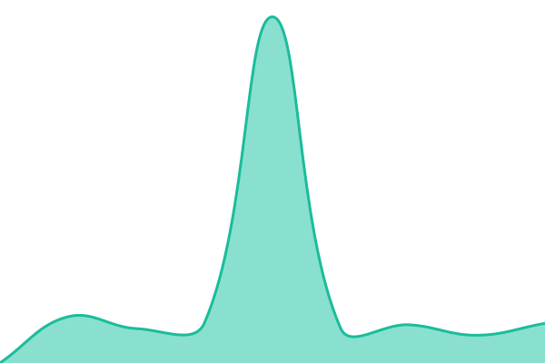

# [📈 Сейчас](https://status.whorl.wtf): <!--live status--> **🟥 Complete outage**

This repository contains the open-source uptime monitor and status page for [xostapov](https://status.whorl.wtf), powered by [Upptime](https://github.com/upptime/upptime).

With [Upptime](https://upptime.js.org), you can get your own unlimited and free uptime monitor and status page, powered entirely by a GitHub repository. We use [Issues](https://github.com/xostapov/whorl-status/issues) as incident reports, [Actions](https://github.com/xostapov/whorl-status/actions) as uptime monitors, and [Pages](https://status.whorl.wtf) for the status page.

## [📈 Live Status](https://demo.upptime.js.org): <!--live status--> **🟥 Complete outage**

<!--start: status pages-->
<!-- This summary is generated by Upptime (https://github.com/upptime/upptime) -->
<!-- Do not edit this manually, your changes will be overwritten -->
<!-- prettier-ignore -->
| URL | Status | History | Response Time | Uptime |
| --- | ------ | ------- | ------------- | ------ |
|  [Сайт и приложение](https://whorl.wtf) | Не работает | [sajt-i-prilozhenie.yml](https://github.com/xostapov/whorl-status/commits/HEAD/history/sajt-i-prilozhenie.yml) | 

 862мс
     
 | 

<a href="https://status.whorl.wtf/history/sajt-i-prilozhenie">99.76%</a>
    

|  [Сообщения](https://whorl.wtf/api/status/messages) | Не работает | [soobshheniya.yml](https://github.com/xostapov/whorl-status/commits/HEAD/history/soobshheniya.yml) | 

 491мс
     
 | 

<a href="https://status.whorl.wtf/history/soobshheniya">99.81%</a>
    

|  [Вход и регистрация](https://whorl.wtf/api/status/auth) | Не работает | [vhod-i-registracziya.yml](https://github.com/xostapov/whorl-status/commits/HEAD/history/vhod-i-registracziya.yml) | 

 483мс
     
 | 

<a href="https://status.whorl.wtf/history/vhod-i-registracziya">99.85%</a>
    

|  [Фото, видео и файлы](https://whorl.wtf/api/status/media) | Не работает | [foto-video-i-fajly.yml](https://github.com/xostapov/whorl-status/commits/HEAD/history/foto-video-i-fajly.yml) | 

 527мс
     
 | 

<a href="https://status.whorl.wtf/history/foto-video-i-fajly">99.90%</a>
    

|  [Уведомления](https://whorl.wtf/api/status/push) | Не работает | [uvedomleniya.yml](https://github.com/xostapov/whorl-status/commits/HEAD/history/uvedomleniya.yml) | 

 484мс
     
 | 

<a href="https://status.whorl.wtf/history/uvedomleniya">99.95%</a>
    

|  [Звонки](https://whorl.wtf/api/status/calls) | Не работает | [zvonki.yml](https://github.com/xostapov/whorl-status/commits/HEAD/history/zvonki.yml) | 

 565мс
     
 | 

<a href="https://status.whorl.wtf/history/zvonki">100.00%</a>
    

<!--end: status pages-->

[**Visit our status website →**](https://status.whorl.wtf)

## 📄 License

- Powered by: [Upptime](https://github.com/upptime/upptime)
- Code: [MIT](./LICENSE) © [Anand Chowdhary](https://anandchowdhary.com)
- Data in the `./history` directory: [Open Database License](https://opendatacommons.org/licenses/odbl/1-0/)
